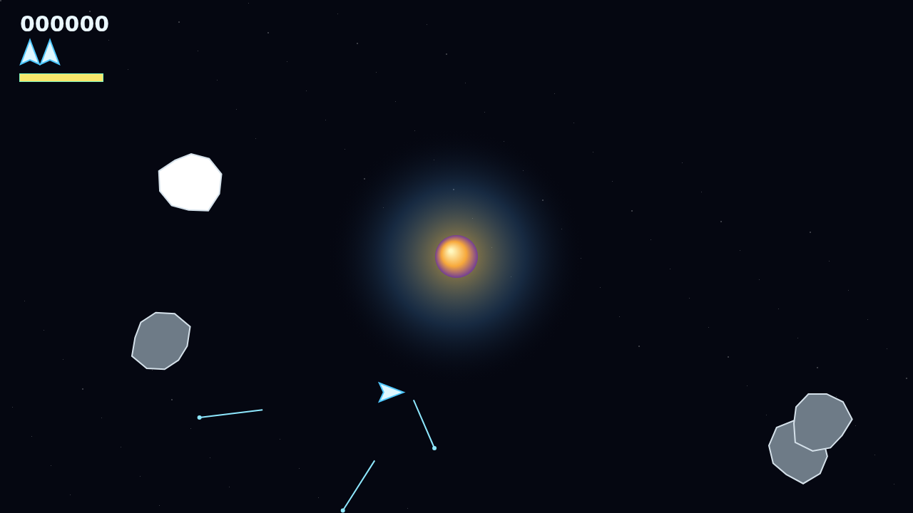
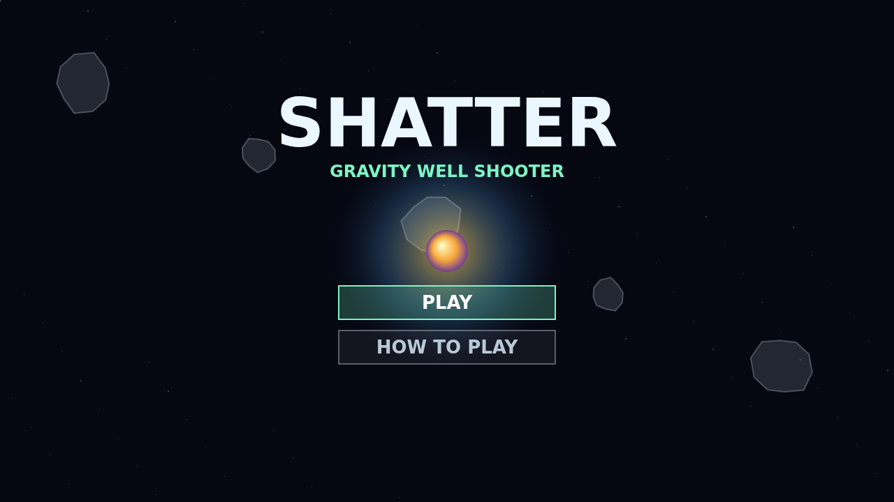

# Shatter

Shatter is a momentum rock shooter built around one dangerous constant: the star at the center of the field bends bullets and rocks, but never your ship. You can fly cleanly by thrust and drift while your shots arc through the well, turning the center of the arena into both hazard and weapon.

Each wave asks you to break armored rocks down through their fragments. Large rocks take several hits before they split, and anything the star swallows comes back from the edge still carrying its damage, so the field keeps churning instead of emptying itself for you.

The Warhead ship carries a homing torpedo for the moments when the board gets too crowded. It recharges over ten seconds, locks into a narrow forward cone, ignores the well, and destroys any rock outright.

The saucer is the pressure valve: it arrives on its own cadence, weaves through the field, and fires into your path. Clear the rocks, curve the shots, spend the torpedo well, and keep enough lives to see the next wave.

